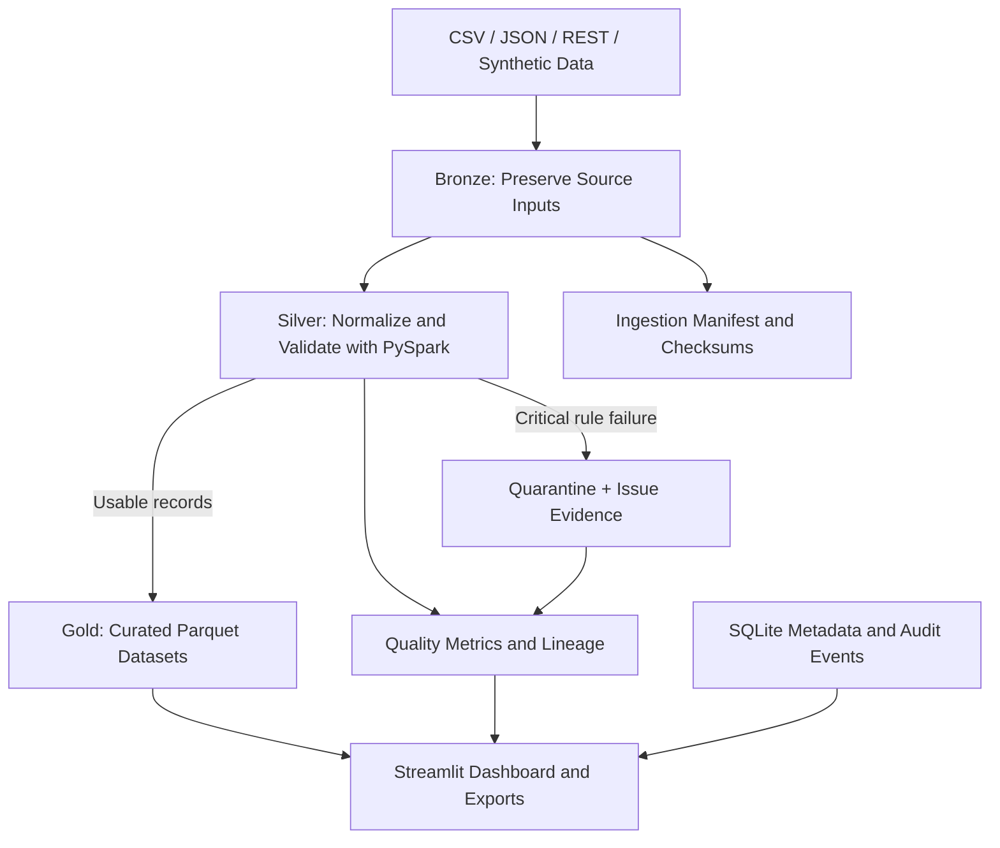

# TrialLock

Clinical Data Quality & Pipeline Observability Workbench

TrialLock is a local-first portfolio project that demonstrates how a clinical research data platform can ingest heterogeneous study data, validate and standardize records, quarantine critical failures, publish analysis-ready datasets, and retain pipeline lineage.

The demo uses a fictional study, **IBD-DEMO-001**, and synthetic data only. It is intended to demonstrate data engineering concepts relevant to clinical research organizations. It is **not** a validated GxP system and must not be used to process real patient data.

## Why TrialLock?

Clinical research data can arrive from electronic data capture, visit management, laboratory, adverse-event, and patient-reported outcome systems. Differences in schemas, duplicate keys, missing identifiers, invalid dates, and broken relationships can create rework before data is ready for analysis.

TrialLock makes those problems visible and traceable through a local web interface and a medallion-style processing pipeline.

## Key capabilities

- **Synthetic study data:** Generate deterministic demo records for subjects, visits, laboratory results, adverse events, and patient-reported outcomes.
- **Data ingestion:** Upload CSV and JSON data and exercise configurable REST ingestion.
- **Medallion pipeline:** Organize data into Bronze, Silver, and Gold layers, with a separate quarantine area for records rejected by configured critical rules.
- **PySpark and Spark SQL:** Perform the core data processing and analytical transformations using local Spark.
- **Configurable validation:** Keep schemas, study protocol settings, and quality rules in YAML configuration.
- **Data quality reporting:** Inspect failed rules, severities, affected entities, record references, and quality metrics.
- **Readiness estimate:** Evaluate unresolved critical/high-severity issues, expected-visit reconciliation, and the configured quality threshold.
- **Lineage and auditability:** Review ingestion and pipeline history, output metadata, and application-level audit hash-chain verification.
- **Gold data explorer:** Inspect curated datasets and export analytical data and quality reports.
- **Automated checks:** Run pytest tests and use the included GitHub Actions and Azure Pipelines configurations once the project source is pushed.

## Architecture



### Data layers

| Layer | Purpose | Typical contents |
|---|---|---|
| Bronze | Preserve source evidence | Original inputs, ingestion manifests, checksums |
| Silver | Normalize and validate | Standardized records, validation status, lineage metadata |
| Quarantine | Make critical failures explicit | Rejected records with rule IDs and failure reasons |
| Gold | Provide curated analytical data | Subject, visit, lab, adverse-event, PRO, and quality-summary datasets |

Gold publication should preserve the last successful output if a new run fails. Reprocessing unchanged inputs should not duplicate business records in the current Gold snapshot.

## Technology stack

- Python 3.11+
- Streamlit
- PySpark and Spark SQL
- SQLite for local metadata and audit records
- Parquet for structured pipeline outputs
- YAML for schemas, validation rules, and protocol configuration
- pytest for tests
- GitHub Actions and Azure Pipelines YAML for CI checks

## Run locally

### Prerequisites

- Python 3.11 or newer
- Java 17 or newer for PySpark
- Git, if cloning the repository

Verify Python and Java from a new terminal:

```powershell
python --version
java -version
```

If Java is not installed, install a compatible Java 17+ distribution and configure `JAVA_HOME` as needed. Restart the terminal after changing environment variables.

### Windows

From the project root:

```powershell
.\run.ps1
```

Or install and run manually:

```powershell
python -m venv .venv
.\.venv\Scripts\Activate.ps1
python -m pip install --upgrade pip
pip install -r requirements.txt
python -m streamlit run app.py
```

### Linux or macOS

```bash
chmod +x run.sh
./run.sh
```

Or install and run manually:

```bash
python3 -m venv .venv
source .venv/bin/activate
python -m pip install --upgrade pip
pip install -r requirements.txt
python -m streamlit run app.py
```

The Streamlit interface may start without Java, but Spark initialization and pipeline execution require a working Java installation. The pipeline is not considered verified until its Spark-backed path has been run successfully.

## Run tests

From the project root, with the virtual environment activated:

```bash
pytest tests/ -v
```

Spark-backed tests require Java. Review the test output to confirm whether integration tests actually ran or were skipped. Do not interpret a skipped Spark test as proof that end-to-end Spark processing works.

## Expected project structure

```text
app.py
triallock/
  config.py
  spark_session.py
  synthetic_data.py
  ingestion.py
  pipeline.py
  schemas.py
  quality_rules.py
  validation.py
  storage.py
  audit.py
  metrics.py
  lineage.py
  readiness.py
  export.py
config/
  schemas.yaml
  validation_rules.yaml
  study_protocol.yaml
tests/
.github/workflows/ci.yml
azure-pipelines.yml
run.ps1
run.sh
requirements.txt
README.md
```

Exact module names can evolve with the implementation.

## Quality score and readiness

The application quality score is defined as:

```text
Quality score = 100 × passed applicable checks / total applicable checks
```

The score is rounded to two decimal places. When no checks apply, the score should be displayed as N/A rather than dividing by zero. Always review counts and issue severity alongside the score.

The readiness indicator follows these rules:

- **BLOCKED:** At least one unresolved BLOCKER issue exists.
- **AT RISK:** No unresolved BLOCKER issues exist, but HIGH issues remain, mandatory visits are unreconciled, or the quality threshold is not met.
- **READY FOR DATA REVIEW:** No unresolved BLOCKER or HIGH issues remain, expected mandatory visits have been reconciled, and the configured quality threshold is met.

This is an internal demo estimate, not a clinical database-lock decision or approval.

## Example demo walkthrough

1. Generate the synthetic IBD-DEMO-001 study.
2. Review the generated source records and injected data-quality defects.
3. Run the pipeline and inspect row counts across Bronze, Silver, quarantine, and Gold.
4. Filter quality issues by severity, rule, and entity.
5. Inspect quarantined records and export the issue report.
6. Explore the curated Gold datasets and run example analytical queries.
7. Rerun processing to inspect idempotency and run history.
8. Verify the audit hash chain and review readiness blockers.

## Local storage

The application uses local paths for processing outputs and SQLite for metadata. Typical runtime directories include:

- `data/bronze/`: source snapshots and raw inputs
- `data/silver/`: normalized data
- `data/gold/`: curated outputs
- `data/quarantine/`: rejected records and failure evidence
- `data/logs/`: application logs

Runtime databases, generated datasets, logs, secrets, and virtual environments should remain outside Git.

## Security and regulatory boundaries

TrialLock is a portfolio prototype using synthetic data. It does not claim HIPAA certification, GxP validation, or compliance with 21 CFR Part 11. Its application-level audit hash chain is tamper-evident only under its stated assumptions; it does not protect against privileged modification of local files.

A production clinical system would require, among other things, validated procedures, access control and identity management, controlled change management, secure secrets handling, backup and recovery, monitoring, and an approved electronic-record and audit-trail framework.

## Limitations to be transparent about

- PySpark processing requires a compatible local Java installation.
- Some Spark SQL transformations may be simplified in this prototype.
- REST ingestion currently uses mock/synthetic endpoints rather than a production-grade external integration.
- Local SQLite and filesystem persistence are for development and demonstration, not a multi-user production deployment.
- Readiness results are estimates driven by configured rules and synthetic protocol schedules.

## Mapping to a potential Azure implementation

| Local prototype | Potential production counterpart |
|---|---|
| Local PySpark | Azure Databricks or Microsoft Fabric Spark |
| Filesystem Bronze/Silver/Gold | ADLS Gen2 or Fabric OneLake |
| Local ingestion workflow | Azure Data Factory or Fabric pipelines |
| SQLite metadata | Azure SQL |
| Streamlit prototype | Internal data portal or Power BI-backed experience |
| GitHub Actions / Azure Pipelines | Automated build, test, and deployment workflows |

These are architectural mappings, not integrations that are already deployed.

## Portfolio focus

TrialLock demonstrates practical data engineering concerns: integrating inconsistent sources, applying reusable quality rules, preserving raw evidence, isolating critical failures, publishing curated datasets safely, and tracing pipeline execution. The most meaningful demo is one where the user can reproduce a run, inspect a specific failure, and trace the outcome through to the published data.

## License

No license has been specified yet. Add a license file before accepting external contributions or explicitly granting reuse rights.
